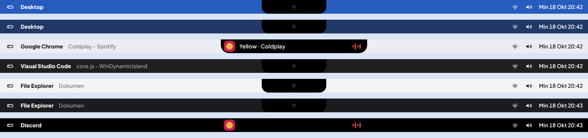
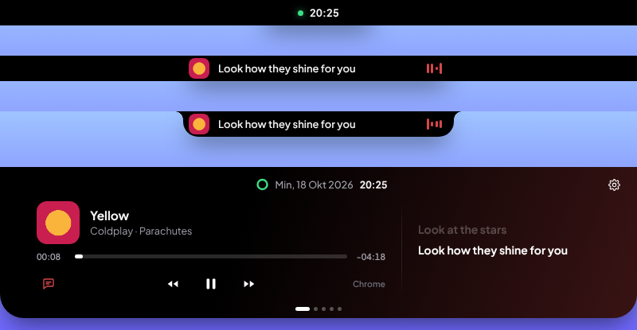
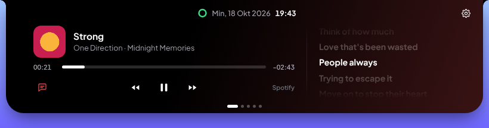
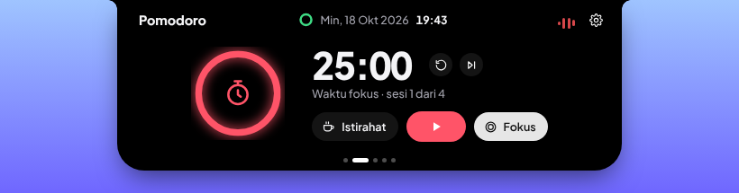
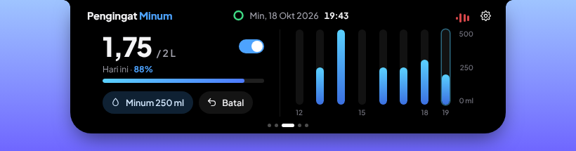
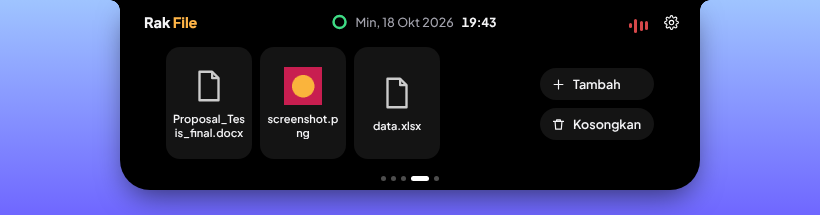
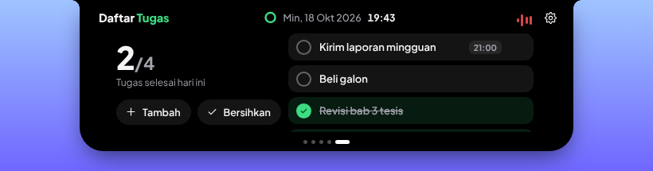
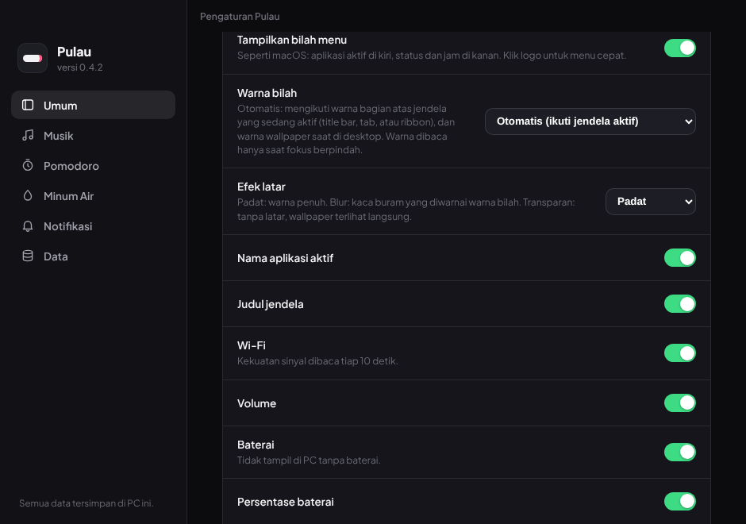

# Pulau (WinDynamicIsland)

*Dynamic Island* untuk Windows 10 dan 11. Sebuah kapsul hitam di tengah atas layar yang menampilkan pemutar musik dengan lirik tersinkron, timer Pomodoro, pengingat minum, rak file, daftar tugas, dan notifikasi sistem. Semua data tersimpan di PC sendiri, tanpa akun dan tanpa server.

> Status: versi 0.6.0. Dibuat dengan Electron. Bagian yang membaca musik dan sistem dari Windows belum diuji pada banyak perangkat, jadi laporan *bug* sangat membantu.

## Fitur

| Fitur | Keterangan |
| --- | --- |
| Musik | Membaca lagu dari Spotify, YouTube di *browser*, dan pemutar lain lewat kontrol media Windows (SMTC). Sampul album, *progress bar* yang bisa diklik, putar, jeda, maju, mundur. |
| Lirik | Lirik tersinkron dari [LRCLIB](https://lrclib.net). Klik satu baris untuk lompat ke bagian itu. Baris yang sedang dinyanyikan juga tampil di kapsul kecil. |
| Warna dinamis | Latar pemutar bergradasi mengikuti warna sampul album. |
| Pomodoro | Fokus, istirahat pendek, istirahat panjang. Durasi, jumlah sesi, bunyi, dan lanjut otomatis bisa diatur. Sisa waktu tampil di kapsul kecil. |
| Minum Air | Catatan per jam, target harian, grafik, dan pengingat berkala pada jam aktif. |
| Rak File | Seret file ke pulau, seret keluar ke aplikasi lain. Hanya menyimpan lokasi file. |
| Daftar Tugas | Tugas harian dengan pengingat jam. Klik dua kali untuk mengubah teks. |
| Notifikasi sistem | Pengisi daya, baterai lemah, *headphone* atau *speaker* terhubung, Caps Lock, volume. |
| Lebar pulau otomatis | Pulau melebar atau menyempit mengikuti panjang teks (judul lagu, notifikasi, tampilan diam) sampai batas lebar maksimal yang bisa diatur (bawaan 400 px). |
| Tampilan saat diam | Isi pulau saat tidak ada musik atau notifikasi bisa dipilih lebih dari satu dan tampil berdampingan: jam, tanggal, teks kustom (maks. 16 karakter), baterai, napas, gelombang, titik kamera, atau mata. Kosongkan semua untuk pulau polos. Ada pilihan kedua yang menggantikannya setelah beberapa saat tanpa aktivitas (bawaan: mata yang mengikuti kursor). |
| Mode *notch* | Area atas layar dicadangkan seperti *notch* MacBook, jadi jendela yang dimaksimalkan tidak tertutup pulau. Bilah hitam penuh, tinggi bilah dapat diatur, pulau otomatis sembunyi saat layar penuh. |
| Bilah menu | Seperti macOS: logo dengan menu cepat, aplikasi aktif dan judul jendela di kiri, Wi-Fi, volume, baterai, tanggal dan jam di kanan. Warna bilah Otomatis mengikuti bagian atas jendela yang aktif (wallpaper saat di desktop), atau Ikuti tema sistem (hitam atau putih). Efek latar dipilih terpisah: Padat, Blur (hanya saat desktop terlihat; wallpaper dikaburkan dan diberi tinta; kekuatan blur 0 sampai 100% dengan 0% berarti transparan, dan kepekatan warna diatur terpisah), atau Transparan. |
| Log aktivitas | Tiga level: Mati, Hanya galat, Semua aktivitas. Ada penampil log di Pengaturan. |
| Pengaturan | Jendela khusus untuk semua opsi, termasuk menyalakan atau mematikan tiap halaman. |

Dokumen kebutuhan produk ada di [docs/PRD.md](docs/PRD.md), rancangan teknis di [docs/ARCHITECTURE.md](docs/ARCHITECTURE.md).

## Agen AI (eksperimental)

Pulau bisa menjadi "tangan" bagi model AI yang kompatibel dengan OpenAI (misalnya Aivene). Fitur ini **mati secara bawaan**: aktifkan di Pengaturan, bagian Agen AI, lalu isi URL API, ID model, dan kunci API (disimpan terenkripsi lewat DPAPI Windows, tidak pernah ditampilkan lagi).

- **Jendela agen** (`Ctrl+Alt+A`): tulis tugas, lihat langkah dan penggunaan token, setujui atau tolak aksi.
- **Aksi yang tersedia untuk model:** tangkapan layar, klik, gulir, ketik, tekan tombol, buka URL atau file berjalur lengkap, tunggu, bertanya ke pengguna. Tidak ada eksekusi perintah shell.
- **Keamanan:** mode izin (bawaan: mengetik, tombol, dan buka file perlu persetujuan), batas langkah, tombol berhenti darurat `Ctrl+Alt+X`, jendela agen tidak ikut terekam di tangkapan layar, teks di layar diperlakukan sebagai data. Hanya layar utama yang dikendalikan.
- **Status** agen tampil di pulau sebagai notifikasi.

Model harus mendukung gambar dan pemanggilan fungsi. Awasi agen saat bekerja, dan pasang batas pengeluaran pada kunci API.

## Tampilan

Gambar di bawah dibuat dengan data contoh.











## Instalasi

1. Buka halaman [Releases](../../releases) atau tab **Actions**, lalu unduh `Pulau Setup x.y.z.exe`.
2. Jalankan *installer*. Jika muncul peringatan Windows SmartScreen, klik **More info** lalu **Run anyway**. Peringatan ini muncul karena *installer* belum ditandatangani secara digital.
3. Pulau berjalan otomatis dan muncul di tengah atas layar. Pengaturan ada di ikon *system tray*.

Persyaratan: Windows 10 atau 11 (64 bit). Lirik dan sampul cadangan membutuhkan internet. Fitur lain bekerja sepenuhnya luring.

## Cara pakai

* Arahkan kursor ke kapsul untuk membukanya. Geser halaman dengan panah kiri kanan, titik di bawah, atau *scroll*.
* Klik ikon gerigi di pojok kanan atas, atau klik ikon *tray*, untuk membuka Pengaturan.
* Klik kanan ikon *tray* untuk menampilkan atau menyembunyikan pulau, mengatur *autostart*, membuka log, atau keluar.

## Pengembangan

Prasyarat: Node.js 20 atau lebih baru, dan Windows untuk menjalankan fitur musik serta notifikasi sistem.

```bash
npm install
npm start          # jalankan dalam mode pengembangan
npm run dist       # bangun installer di folder dist/
```

Di Linux atau macOS, antarmuka tetap bisa dibuka untuk pengerjaan tampilan, tetapi data musik dan sistem tidak tersedia karena memakai PowerShell dan API Windows.

*Installer* juga dibangun otomatis oleh GitHub Actions (`.github/workflows/build.yml`) pada setiap *push*. Untuk membuat rilis, beri *tag* `v0.6.0` dan hasilnya terlampir di halaman Releases.

## Struktur proyek

```
main.js          proses utama Electron: jendela, tray, IPC, jembatan PowerShell
preload.js       API aman yang diekspos ke antarmuka
store.js         penyimpanan lokal (satu file JSON)
logger.js        pencatat aktivitas dan galat
appbar.js        mode notch lewat AppBar Windows (koffi + shell32)
desktop.js       aplikasi aktif, warna wallpaper, warna bagian atas jendela aktif (koffi + user32/gdi32/dwmapi)
media.ps1        pembaca media, volume, dan Caps Lock Windows
renderer/        antarmuka pulau dan jendela pengaturan
  js/            modul per fitur (music, pomodoro, water, shelf, todo, system)
docs/            PRD, arsitektur, roadmap
```

## Data dan privasi

* Pengaturan, tugas, catatan minum, dan isi rak file disimpan di `%APPDATA%\Pulau\pulau-data.json`.
* Log disimpan di `%APPDATA%\Pulau\pulau.log` dan tidak pernah dikirim ke mana pun. Pada level Semua aktivitas, log memuat judul lagu dan teks tugas.
* Tidak ada akun, analitik, atau pelacakan.
* Permintaan jaringan hanya dua: pencarian lirik ke LRCLIB (judul, nama artis, nama album, durasi) dan, bila Windows tidak menyediakan sampul, pencarian sampul ke iTunes Search (judul dan nama artis). Pencarian sampul dapat dimatikan di Pengaturan, bagian Musik.

## Pemecahan masalah

* **Kapsul hanya menampilkan jam padahal musik diputar:** buka Pengaturan, bagian Data, ubah **Catat ke log** menjadi **Semua aktivitas**, ulangi masalahnya, lalu lampirkan isi log pada *issue*.
* **Jendela masih tertutup pulau:** pastikan **Potong layar seperti notch** aktif. Jendela yang sudah terbuka mungkin perlu dimaksimalkan ulang. Bila log berisi `AppBar tidak tersedia`, laporkan sebagai *issue*.
* **Area atas tetap kosong setelah Pulau ditutup paksa:** Windows biasanya memulihkannya sendiri. Bila tidak, buka lalu tutup Pulau dari menu *tray*, atau mulai ulang Explorer.
* **Sampul album tidak tampil:** buka log. Baris `thumbnail:` menjelaskan apakah pemutar tidak mengirim gambar atau gambar gagal dibaca. Pastikan juga **Cari sampul secara online** aktif di Pengaturan.
* **Blur tampak polos:** di belakang bilah hanya ada wallpaper, jadi blur terlihat paling jelas pada wallpaper yang bermotif. Naikkan **Kekuatan blur** untuk kabur lebih kuat, atau kecilkan **Kepekatan warna** bila tinta terlalu menutupi. Di log, baris `[bilah] Irisan wallpaper untuk blur siap` menandakan wallpaper berhasil dibaca.
* **Warna bilah tidak mengikuti jendela aktif:** di log Semua aktivitas, cari baris `[bilah] Warna <aplikasi>`. Isinya warna yang terbaca atau alasan gagal (misalnya `BitBlt gagal`), plus koordinat jendela dan baris yang dibaca. Kirim baris itu ke *issue*.
* **Ingin memastikan tidak ada kebocoran memori:** dengan log Semua aktivitas, baris `[kinerja]` dicatat tiap 10 menit berisi total memori dan CPU semua proses Pulau, plus rincian per proses (pulau, pengaturan, blur, GPU). Angka yang terus naik selama berjam-jam menandakan kebocoran, dan Pulau sendiri mencatat peringatan bila memori naik lebih dari dua kali lipat.
* **Pengingat atau notifikasi tidak muncul:** periksa pengaturan **Notifikasi**.
* **Peringatan SmartScreen:** lihat bagian Instalasi.

## Batasan yang diketahui

* Timer pada aplikasi Clock bawaan Windows tidak bisa dibaca aplikasi lain. Gunakan Pomodoro di Pulau.
* Persentase baterai *headphone* tidak tersedia, hanya status terhubung atau terputus.
* Kecerahan layar dan Wi-Fi belum didukung. Lihat [docs/ROADMAP.md](docs/ROADMAP.md).
* Pulau dan bilah notch hanya tampil di monitor utama.
* Saat mode *notch* aktif, bilah memakan seluruh lebar layar setinggi bilah, sama seperti bilah menu MacBook.

## Kontribusi

Lihat [CONTRIBUTING.md](CONTRIBUTING.md). Riwayat perubahan ada di [CHANGELOG.md](CHANGELOG.md).

## Lisensi

[MIT](LICENSE). Font Plus Jakarta Sans berlisensi SIL Open Font License. Proyek ini tidak berafiliasi dengan Apple maupun pembuat aplikasi sejenis.
